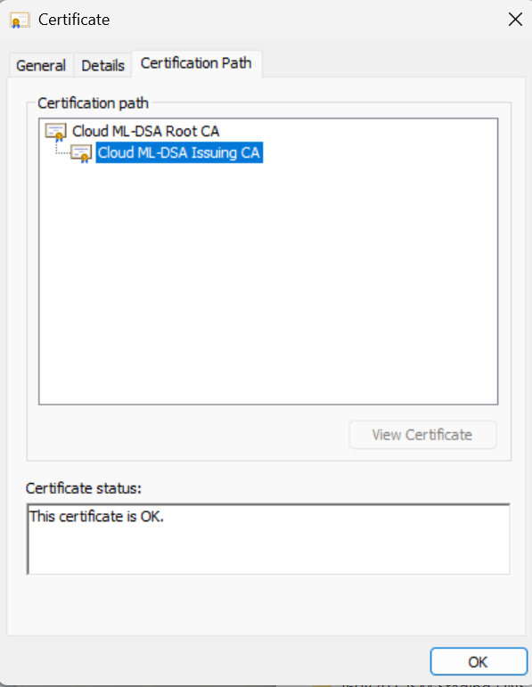
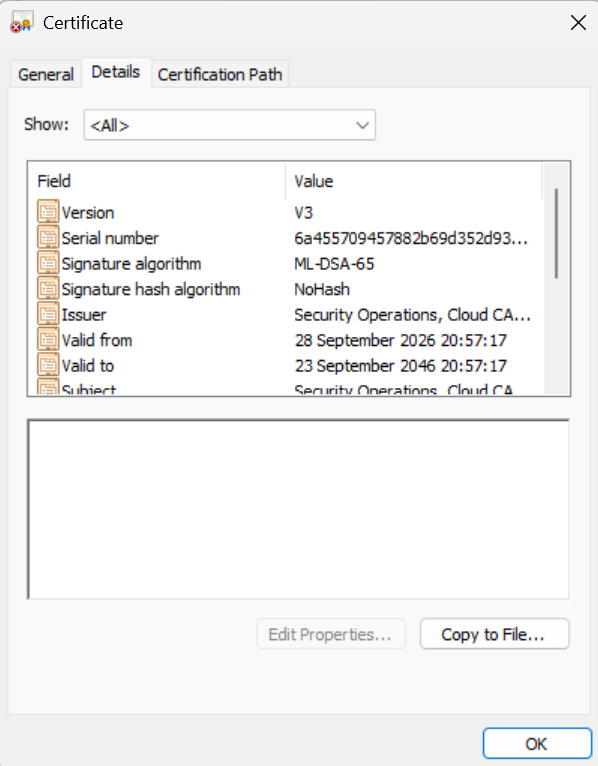
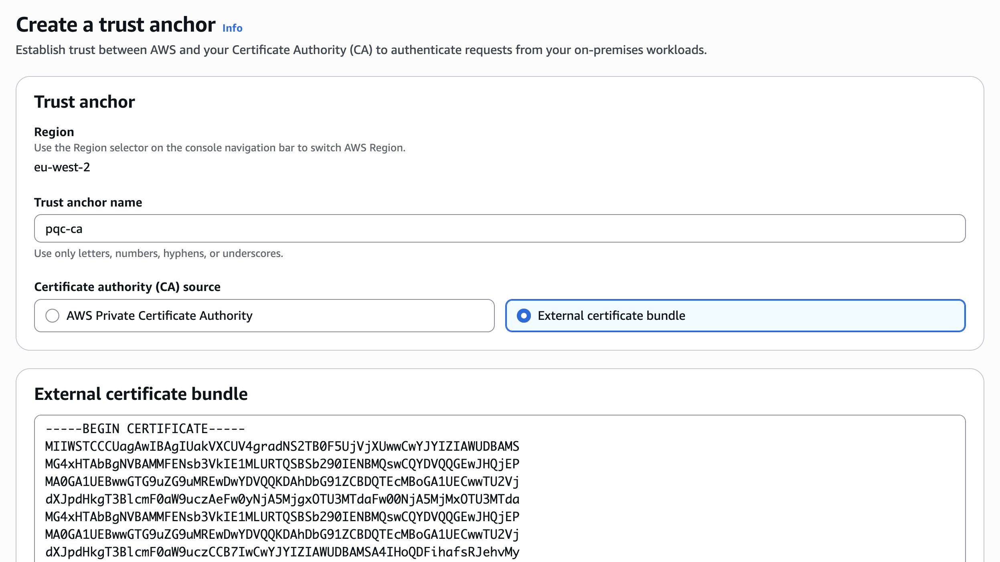
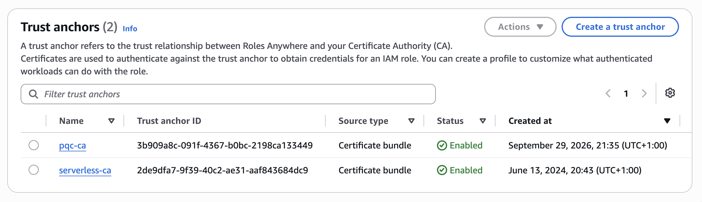
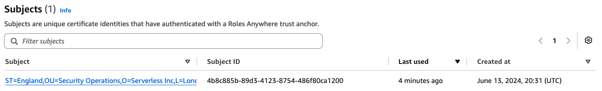
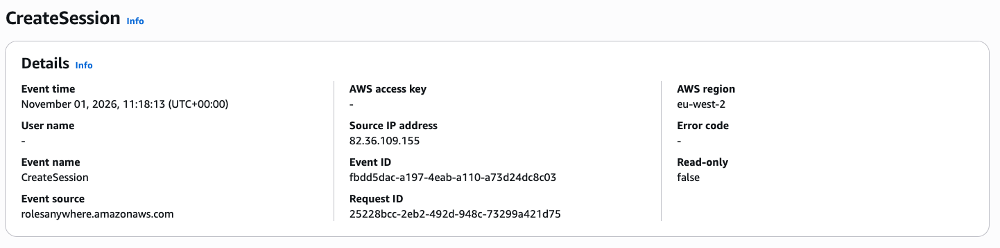

# IAM Roles Anywhere with post-quantum cryptography

A step-by-step guide to setting up AWS IAM Roles Anywhere with ML-DSA (Module-Lattice Digital Signature Algorithm) certificates issued by the [open-source serverless CA](https://github.com/serverless-ca/terraform-aws-ca).



## Introduction

AWS announced post-quantum cryptography support for IAM Roles Anywhere in March 2026. This guide walks through configuring IAM Roles Anywhere with fully post-quantum ML-DSA client certificates.

## Create a post-quantum serverless CA

First, follow the [Open-source post-quantum cryptography serverless CA](pqc-ca.md) guide to create an ML-DSA CA.

This example adds an ML-DSA CA alongside an existing ECDSA CA. After deployment, download the root and issuing ML-DSA CA certificates from your CA's public endpoint. For example:

* Root PQC CA: `https://certs.cloud-ca.com/pqc-root-ca-dev.crt`
* Issuing PQC CA: `https://certs.cloud-ca.com/pqc-issuing-ca-dev.crt`




Your CA certificates will be available from the equivalent domain and URLs for your deployment.

## Configure IAM Roles Anywhere

Download your CA bundle from its public endpoint, for example `https://certs.cloud-ca.com/pqc-ca-bundle-dev.pem`. If your CA information is private, download the bundle from the S3 bucket with `external` in its name.

For the role, trust policy, and optional session policy profile, follow the [IAM Roles Anywhere with open-source private CA](iam.md) guide.

### Create a trust anchor

In your Application AWS account:

1. Open **IAM → Roles**, scroll to **Roles Anywhere**, and select **Manage**.
2. Choose **Create a trust anchor** and select your region.
3. Give the trust anchor a name, such as `pqc-ca`.
4. Select **External certificate bundle** and paste in the CA bundle.
5. Leave the notification defaults, add tags if desired, and create the trust anchor.



This example places the ML-DSA trust anchor in the same account and region as the existing ECDSA trust anchor.



## Download the AWS IAM Roles Anywhere Credential Helper

Download version 1.8.5 or later of the [AWS IAM Roles Anywhere Credential Helper](https://docs.aws.amazon.com/rolesanywhere/latest/userguide/credential-helper.html) for your operating system.

* Copy the binary into your home directory, or install it elsewhere and add that directory to your `PATH`.
* On macOS, remove the extended attribute with `xattr -c aws_signing_helper`.
* Make the binary executable with `chmod 755 aws_signing_helper`.

## Obtain an ML-DSA client certificate

Issue a fully post-quantum client certificate from your ML-DSA CA using credentials for your CA AWS account:

```bash
git clone https://github.com/serverless-ca/terraform-aws-ca.git
cd terraform-aws-ca
pip install -r utils/requirements.txt
python utils/client-cert.py --profile <your-aws-profile> --keyalgo ml-dsa-44 --project pqc
```

* The ML-DSA-44 key pair is generated locally.
* The CSR is signed with the local ML-DSA key and submitted to the `tls-cert` Lambda function, which issues a certificate signed by the ML-DSA issuing CA.
* `--project pqc` targets the ML-DSA deployment when multiple CAs share the AWS account, as in the example deployment. Omit it if your account has a single CA.
* The certificate, private key (PKCS8), and CA bundle are written to `~/certs`.

Using OpenSSL 4, verify and inspect the certificate:

```bash
openssl verify -CAfile ~/certs/ca-bundle.pem ~/certs/client-cert.crt
openssl x509 -in ~/certs/client-cert.crt -text -noout
```

## Convert the ML-DSA private key format

The AWS IAM Roles Anywhere Credential Helper version 1.8.5 supports only one of the three ML-DSA private key formats allowed by RFC 9881. This is not the format produced by Python Cryptography. Convert the key using OpenSSL 4:

```bash
openssl pkey -in ~/certs/client-key.pem -provparam ml-dsa.output_formats=seed-priv -out ~/certs/client-key-seedpriv.pem
openssl asn1parse -in ~/certs/client-key-seedpriv.pem -strparse 20 | cut -c1-60
```

The `asn1parse` output should show `SEQUENCE`, `OCTET STRING l=32`, and `OCTET STRING l=2560`.

## Set up an AWS CLI profile

Edit `~/.aws/config` and add a profile using your own ARNs:

```ini
[profile pqc]
    credential_process = ./aws_signing_helper credential-process --certificate certs/client-cert.crt --private-key certs/client-key-seedpriv.pem --trust-anchor-arn arn:aws:rolesanywhere:REGION:ACCOUNT_ID:trust-anchor/TRUST_ANCHOR_ID --profile-arn arn:aws:rolesanywhere:REGION:ACCOUNT_ID:profile/PROFILE_ID --role-arn arn:aws:iam::ACCOUNT_ID:role/ROLE_NAME
```

For example:

```ini
[profile pqc]
    credential_process = ./aws_signing_helper credential-process --certificate certs/client-cert.crt --private-key certs/client-key-seedpriv.pem --trust-anchor-arn "arn:aws:rolesanywhere:eu-west-2:992382525818:trust-anchor/3b909a8c-091f-4367-b0bc-2198ca133449" --profile-arn "arn:aws:rolesanywhere:eu-west-2:992382525818:profile/86227258-a142-433d-a4bc-6015c99b39b9" --role-arn "arn:aws:iam::992382525818:role/roles-anywhere-s3-full-access"
```

Replace the example ARNs with your own and save the file.

## Test access

Check the AWS identity:

```bash
aws sts get-caller-identity --profile pqc
```

You should receive a response similar to:

```json
{
    "UserId": "AROA6ODU3UF5DTDLJCYVE:401f1972253b0bb86bd62ac8285ad6236cc8f45a",
    "Account": "992382525818",
    "Arn": "arn:aws:sts::992382525818:assumed-role/roles-anywhere-s3-full-access/401f1972253b0bb86bd62ac8285ad6236cc8f45a"
}
```

Listing all S3 buckets should fail because access is restricted to a single bucket:

```bash
aws s3 ls --profile pqc
```

```text
An error occurred (AccessDenied) when calling the ListBuckets operation: User: arn:aws:sts::992382525818:assumed-role/roles-anywhere-s3-full-access/401f1972253b0bb86bd62ac8285ad6236cc8f45a is not authorized to perform: s3:ListAllMyBuckets because no session policy allows the s3:ListAllMyBuckets action
```

Downloading an object from the designated bucket should succeed. Replace the example bucket and object with your own:

```bash
aws s3 cp s3://cloud-apps-confidential/confidential.png confidential.png --profile pqc
```

Optionally, set this profile as your AWS CLI default so you do not need to specify `--profile`.

## View connection details

In **IAM → Roles → Roles Anywhere**, navigate to your region and select **Subject Activity** to view connection records. Select a record to view the certificate used to authenticate.



In CloudTrail, search for the `CreateSession` event from the `rolesanywhere.amazonaws.com` event source to view details about the client, role, and trust anchor.



Congratulations, you have set up and tested AWS IAM Roles Anywhere with post-quantum cryptography using the open-source private CA.
